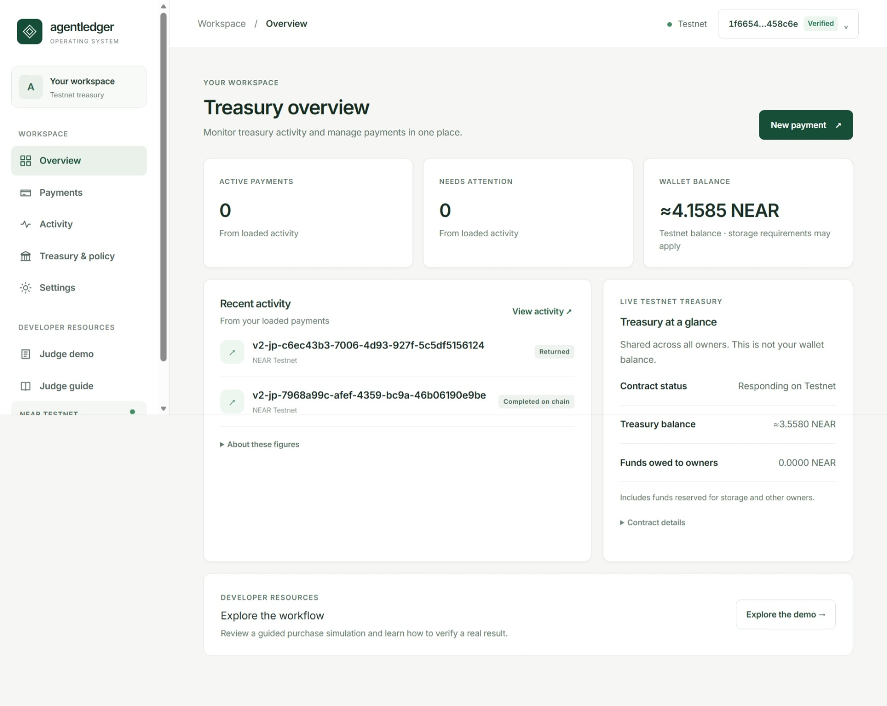
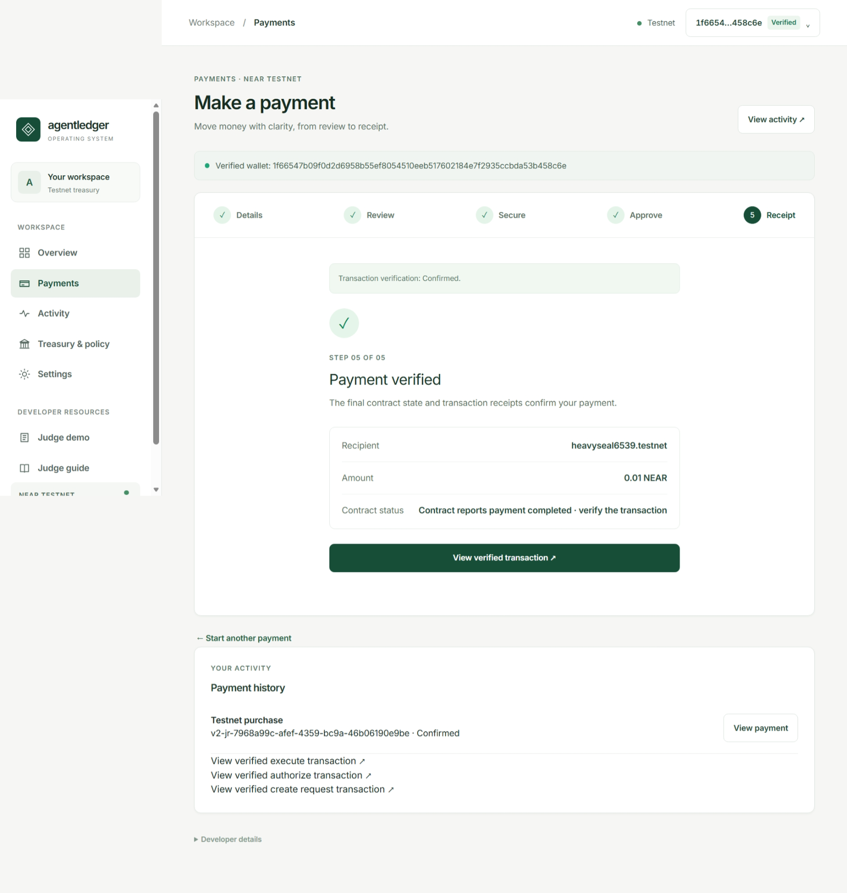
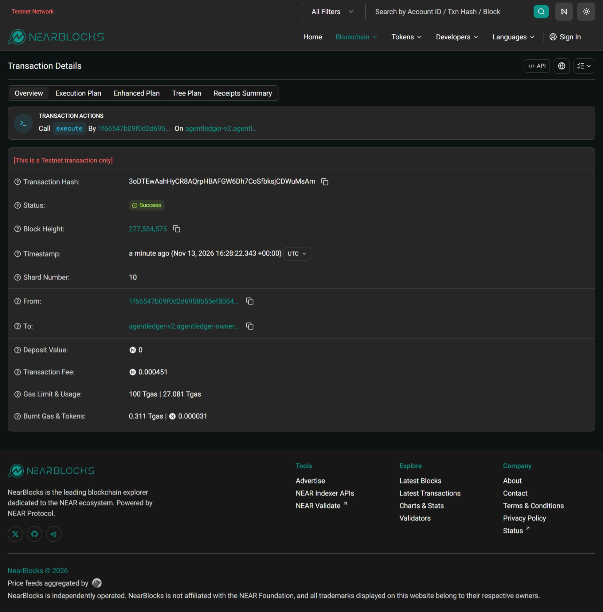
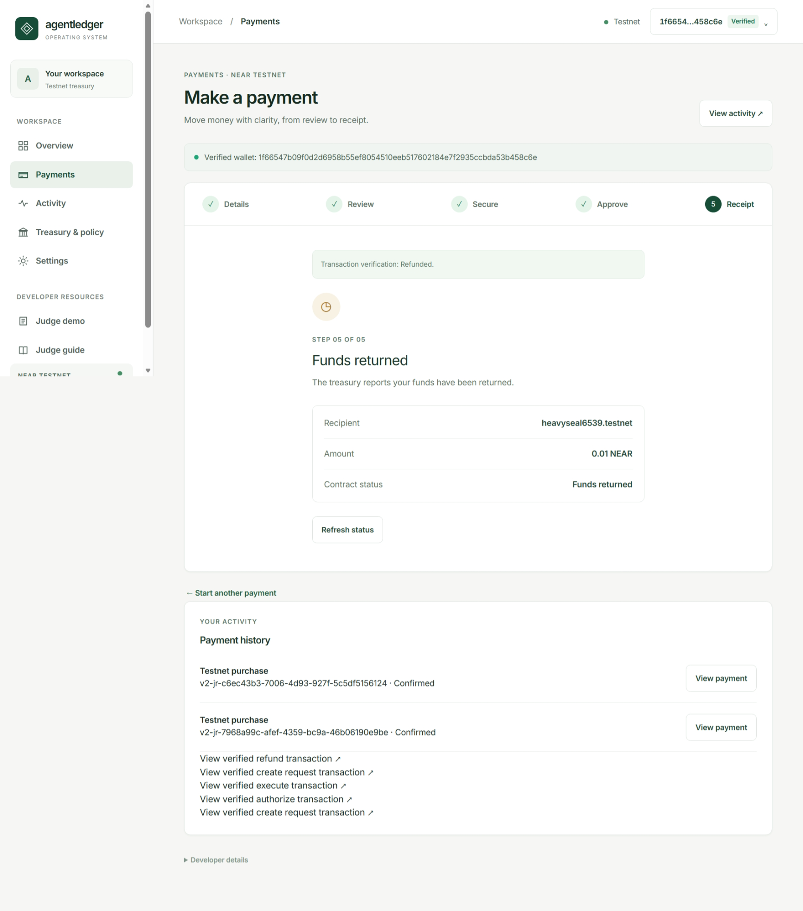
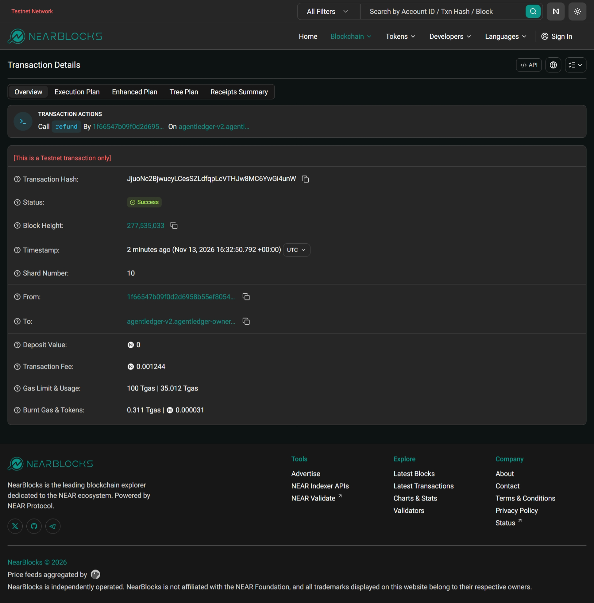

# AgentLedger V2 judge guide

AgentLedger V2 uses the NEAR Testnet contract `agentledger-v2.agentledger-owner.testnet`. Open the application and select **Judge demo** to inspect the two historical scenarios below without connecting a wallet. The separate guided purchase simulation is labeled **SIMULATED** and is not on-chain evidence.

## Scenario 1: execute a payment

1. A Testnet owner created a 0.01 NEAR request for `heavyseal6539.testnet`. The attached 0.04 NEAR comprised the payment plus a nonrefundable 0.03 NEAR storage contribution: [creation transaction](https://testnet.nearblocks.io/txns/69xhE4zxpwdaGEa4NpiH9SPafJcCK42Kt53owemM2SFc).
2. The owner approved the same recipient and amount: [authorization transaction](https://testnet.nearblocks.io/txns/EGFiost8ioVnfPZ359yxaMzprsiTGoxmGDJqDAr1nu8B).
3. The owner executed the request: [execute transaction](https://testnet.nearblocks.io/txns/3oDTEwAahHyCR8AQrpHBAFGW6Dh7CoSfbksjCDWuMsAm). The finalized result and callback succeeded; the successful transfer receipt shows 0.01 NEAR to `heavyseal6539.testnet`, and the finalized request reports `Completed` with zero remaining.

Request ID: `v2-jr-7968a99c-afef-4359-bc9a-46b06190e9be`.

## Scenario 2: refund a payment

1. The same Testnet owner created a separate 0.01 NEAR request with the 0.03 NEAR storage contribution: [creation transaction](https://testnet.nearblocks.io/txns/Hvu519Y1sX8shUbfnmBzJVk7oMNjVXuAMMmpZUupnQ6G).
2. The owner returned the remaining payment funds: [refund transaction](https://testnet.nearblocks.io/txns/JjuoNc2BjwucyLCesSZLdfqpLcVTHJw8MC6YwGi4unW). The finalized result and callback succeeded; the successful transfer receipt shows 0.01 NEAR to the request owner, and the finalized request reports `Refunded` with zero remaining. The storage contribution is not refunded.

Request ID: `v2-jr-c6ec43b3-7006-4d93-927f-5c5df5156124`.

## Try your own Testnet flow

When the deployed payment gate is enabled and the service is configured, connect a Nightly or Sender Testnet wallet, select **Verify identity**, and open **Payments**. Review the recipient, amount, 0.03 NEAR nonrefundable storage contribution, and network fees. Create the request, authorize it, and either execute or refund when eligible. Each on-chain operation needs separate explicit wallet approval. The app limits a new payment to 0.01 NEAR. The evidence above is historical and does not establish the current payment gate or availability.

Use **Activity** or the read-only verification page to inspect your own results. If an operation is rejected, interrupted, or marked UNKNOWN, check the original transaction and reconcile it; do not submit it again automatically. Explorer links for your own saved intents appear only when the app has verified the corresponding result.

## Visual evidence

The following screenshots were captured from the real V2 Testnet testing sessions.

