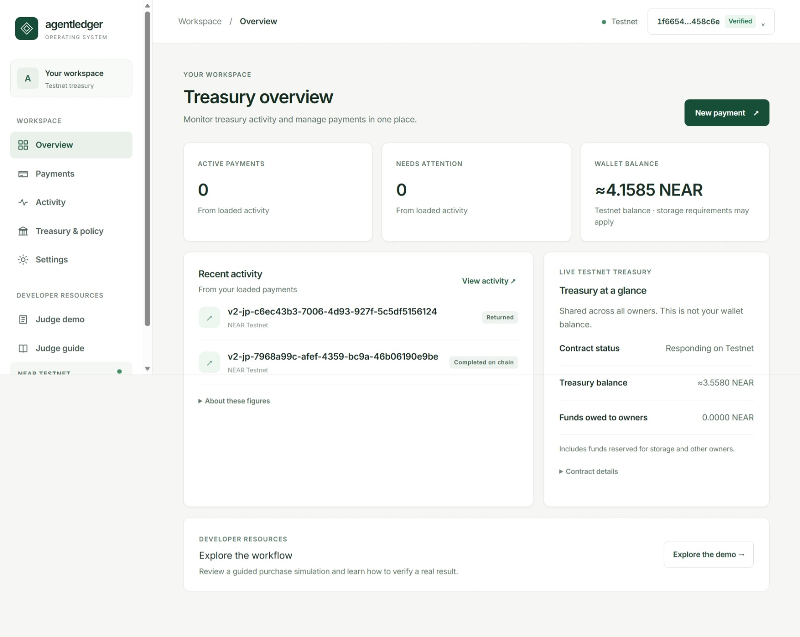
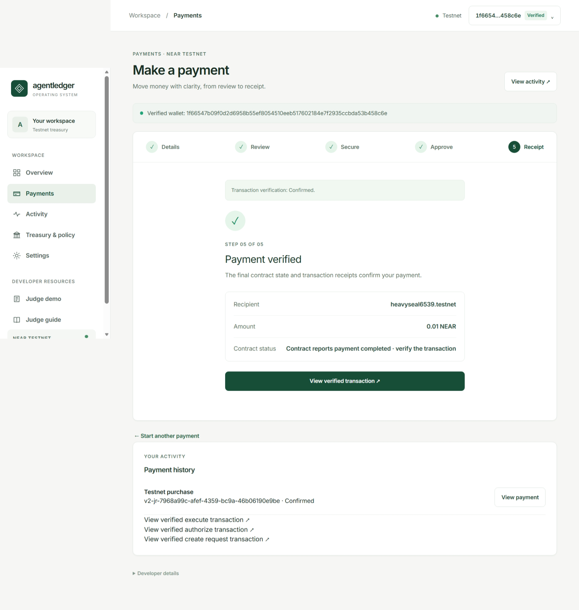
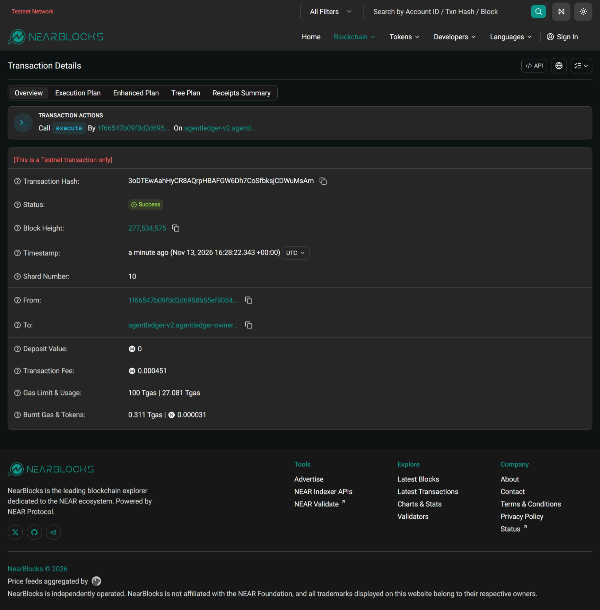
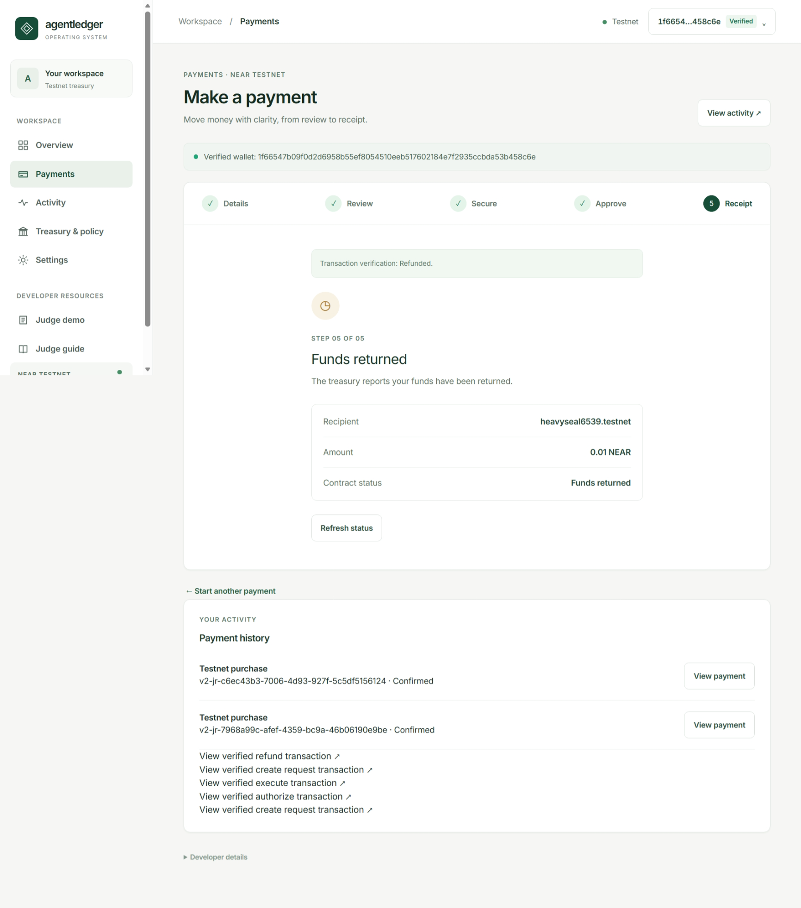
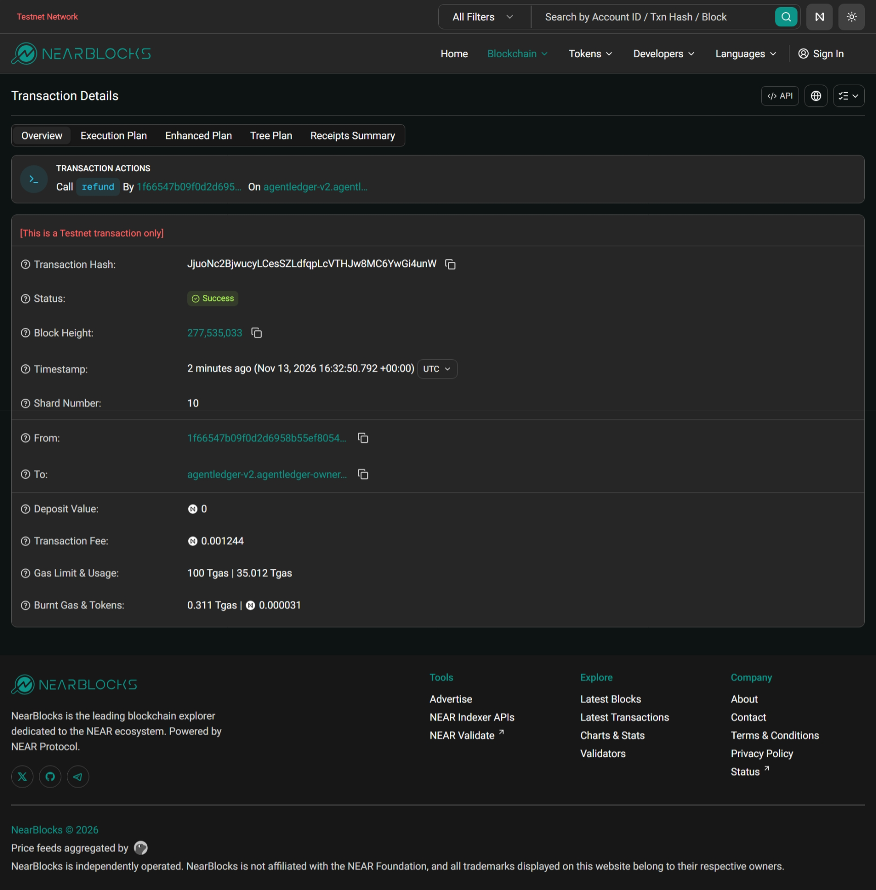
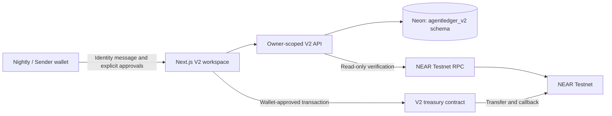

# AgentLedger OS V2

**A NEAR Testnet treasury workspace for reviewing and executing owner-approved payments.** AgentLedger combines a guided procurement review, wallet-based approvals, an isolated transaction-intent store, and on-chain receipt verification. The live payment workflow is designed for a human wallet owner to stay in control; the application does not autonomously sign transactions.

[Open the application](https://agentledger-os.vercel.app) · [Read-only judge demo](https://agentledger-os.vercel.app/v2/demo) · [Judge walkthrough](JUDGE_GUIDE.md) · [Testnet deployment and payment evidence](V2_TESTNET_DEPLOYMENT_EVIDENCE.md)

> **Testnet only.** Payment availability depends on the deployed configuration and the V2 feature gate. Historical successful transactions demonstrate the recorded scenarios; they do not guarantee that the current deployment is enabled or that every wallet and recovery path has been verified.

## Why AgentLedger?

A wallet approval is only the beginning of a payment workflow.
After submission, an application must distinguish a confirmed transfer
from a pending, failed, or uncertain outcome.

AgentLedger OS V2 addresses three problems:

1. **Uncertain settlement:** verify finalized on-chain evidence
   before reporting that a payment succeeded.
2. **Duplicate-payment risk:** preserve transaction intent and
   original evidence instead of automatically retrying unknown outcomes.
3. **Disconnected oversight:** bring owner-approved actions,
   payment history, contract state, and treasury visibility into
   one NEAR Testnet workspace.

**The principle:** automation can assist with reviewing and tracking
payments, but the wallet owner authorizes every blockchain action.

This is a Testnet demonstration of that workflow, not an audited
production payment system.

## What it does

- **Review a payment:** enter a Testnet recipient and amount, then review a deterministic procurement and financial assessment before preparing an action. The separate guided demo uses simulated values and does not move funds.
- **Use your own wallet:** connect a supported Nightly or Sender wallet and verify identity with a browser-bound NEP-413 message. Each blockchain operation requires a separate, explicit wallet approval.
- **Manage the lifecycle:** create and fund a request, authorize it, execute it, or refund remaining funds when the contract permits. The initial application cap is **0.01 NEAR** per payment.
- **Track and recover:** inspect owner-scoped payment history, record the original transaction hash, and reconcile finalized transaction, receipt, callback, and contract-state evidence. `UNKNOWN` outcomes remain locked; the app does not automatically retry an uncertain transaction.
- **Review the treasury:** see Testnet contract balance and liabilities alongside the connected wallet balance, with unavailable states when the data cannot be retrieved. Shared contract funds are not presented as a user's available balance.

The procurement/CFO and Guardian assessments are advisory, rule-based checks. An optional provider can supply explanatory text through `/api/evaluate`; neither an AI response nor a demo action authorizes a payment.

## Verified Testnet scenarios

The following are **real historical on-chain transactions**, distinct from the labeled simulation. Both calls finalized successfully, and the recorded transfer and contract callback receipts succeeded.

| Scenario | Result | Evidence |
| --- | --- | --- |
| Execute | 0.01 NEAR transferred to `heavyseal6539.testnet`; request ended `Completed`. | [Execute on NearBlocks](https://testnet.nearblocks.io/txns/3oDTEwAahHyCR8AQrpHBAFGW6Dh7CoSfbksjCDWuMsAm) |
| Refund | 0.01 NEAR returned to the request owner; request ended `Refunded`. | [Refund on NearBlocks](https://testnet.nearblocks.io/txns/JjuoNc2BjwucyLCesSZLdfqpLcVTHJw8MC6YwGi4unW) |

Each request was created with a 0.01 NEAR payment budget and a **0.03 NEAR nonrefundable storage contribution**, for 0.04 NEAR attached, plus network fees. The [judge guide](JUDGE_GUIDE.md) links the corresponding creation and authorization transactions and explains how to inspect both paths. The deployed contract is `agentledger-v2.agentledger-owner.testnet`.

## Verified End-to-End Testnet Evidence

These screenshots document real NEAR Testnet payment and refund transactions, not simulated demo results.

### Treasury dashboard



### Successful payment execution — 0.01 NEAR





[Verify execution on NearBlocks](https://testnet.nearblocks.io/txns/3oDTEwAahHyCR8AQrpHBAFGW6Dh7CoSfbksjCDWuMsAm)

### Successful refund — 0.01 NEAR





[Verify refund on NearBlocks](https://testnet.nearblocks.io/txns/JjuoNc2BjwucyLCesSZLdfqpLcVTHJw8MC6YwGi4unW)

The screenshots show two successful historical payment paths. They do not establish independent security auditing or complete coverage of every failure scenario.

## Judge instructions

1. Open the [application](https://agentledger-os.vercel.app), then choose **Judge demo** under Developer Resources. The execute and refund evidence can be inspected without connecting a wallet.
2. Open each NearBlocks link to inspect its transaction and receipts. The [judge guide](JUDGE_GUIDE.md) also provides the request IDs and the earlier lifecycle transactions.
3. To explore the interface without a wallet, use the explicitly labeled **SIMULATED** purchase walkthrough. It is not evidence of an on-chain payment.
4. To try your own Testnet flow **only when the deployment is configured and payments are enabled**, connect Nightly or Sender, verify identity, and open **Payments**. Review the recipient, amount, nonrefundable storage contribution, and gas; approve each transaction in your wallet. Use **Activity** to inspect results and reconcile the original transaction if an outcome is uncertain.

## Architecture



The server uses `V2_DATABASE_URL` for the isolated V2 schema and does not fall back to the legacy `DATABASE_URL`. V2 intent claims and wallet sessions are scoped to the authenticated owner; the contract binds requests to the creating account and recipient. The server validates the configured Testnet contract and code hash before payment preparation and reconciles finalized evidence before recording a terminal result.

| Location | Purpose |
| --- | --- |
| [`app/`](app/) | Next.js workspace, wallet flow, and V2 API routes |
| [`lib/server/`](lib/server/) | Authentication, V2 database access, claims, and reconciliation |
| [`v2-contract/`](v2-contract/) | V2 NEAR treasury contract source |
| [`db/migrations/202611130001_v2_namespace.sql`](db/migrations/202611130001_v2_namespace.sql) | V2 schema definition; not an automatic setup step |
| [`tests/`](tests/) | Application, wallet, recovery, and sandbox tests |

## Local development

Install dependencies and start the app:

```sh
npm ci
cp .env.example .env.local
npm run dev
```

Configure a separately verified isolated V2 Testnet database URL and exact `APP_ORIGIN` in the ignored `.env.local` only when needed. The server guard requires the expected direct V2 endpoint, `neondb`, and verified TLS. Set the V2 contract ID and reviewed WASM hash from `.env.example`. The example keeps `PAYMENTS_ENABLED`, `JUDGE_PAYMENTS_ENABLED`, and `V2_PAYMENTS_ENABLED` false. Do not commit credentials, use the Neon main branch for V2, or run migrations as an implicit setup step.

```sh
npm test
npm run typecheck
npm run lint
npm run build
```

## Security and limitations

- **Not independently audited.** This is Testnet software, not a production custody or financial service. Contract, application, database role, and operational assumptions need independent review.
- **Payment gates are explicit.** V2 signing requires `V2_PAYMENTS_ENABLED=true` and both legacy flags `PAYMENTS_ENABLED=false` and `JUDGE_PAYMENTS_ENABLED=false`; each operation still requires wallet approval. Do not assume the deployment's current gate state from this README.
- **Cap and costs differ by layer.** The app limits new payments to 0.01 NEAR; the deployed contract permits budgets up to 0.1 NEAR. The 0.03 NEAR storage contribution is nonrefundable, and gas is additional.
- **Unknown is not failure.** A rejected, interrupted, or missing wallet response can remain unresolved. Preserve the original identifiers and hash; a missing callback can leave an operation pending indefinitely. A narrowly verified hashless creation recovery exists, but other uncertain operations require their original evidence. Never automatically resubmit.
- **Database and wallet boundaries matter.** The backend database role is trusted infrastructure; the application does not provide an independent security boundary against a compromised database role. Verify branch identity, TLS, privileges, and recovery procedures before changing production configuration. Public chain data is not private, and a recipient's address format does not establish trustworthiness.
- **Evidence has limits.** The execute and refund transactions above prove those two recorded Testnet scenarios. They do not establish a security audit, all-device wallet compatibility, or successful recovery of every interruption.

Historical V1-only plans and reviews are preserved under [docs/archive/v1](docs/archive/v1/README.md). V2 documentation and transaction evidence remain at the repository root.
